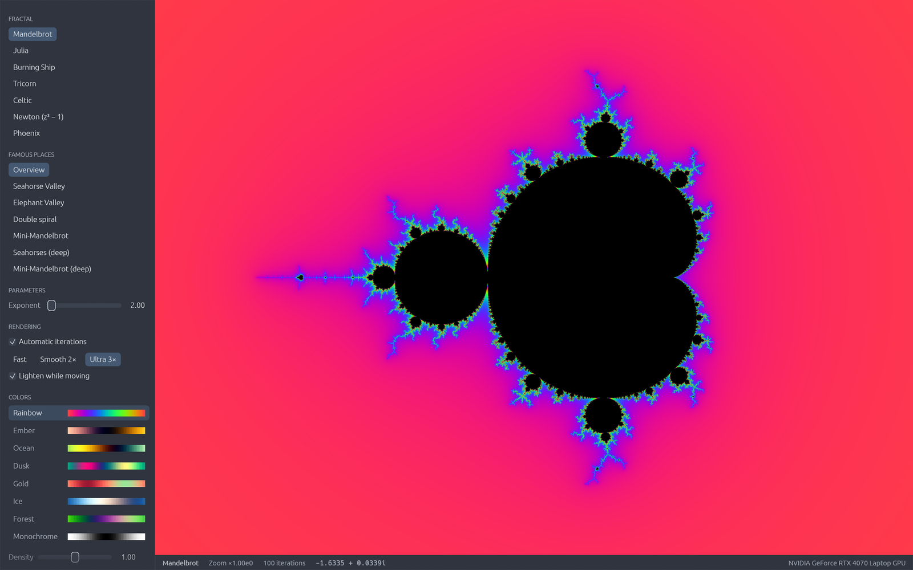
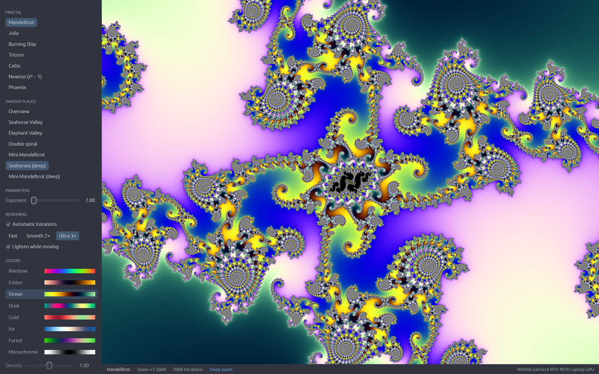
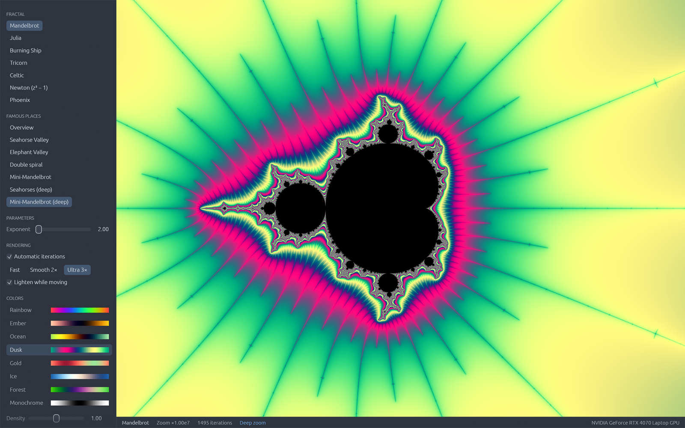
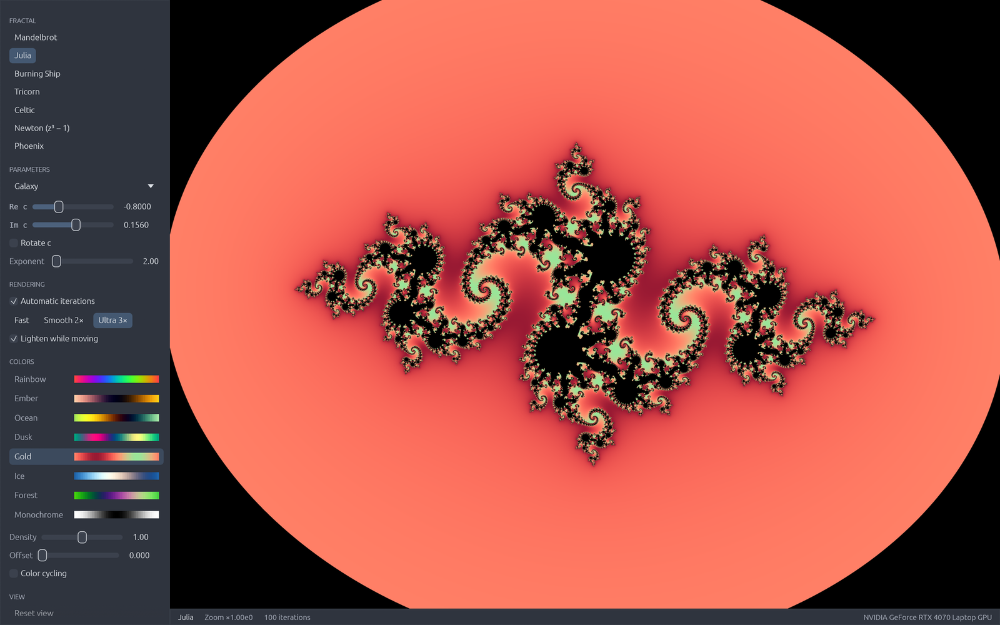
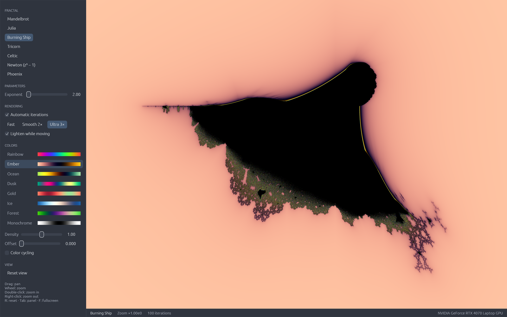
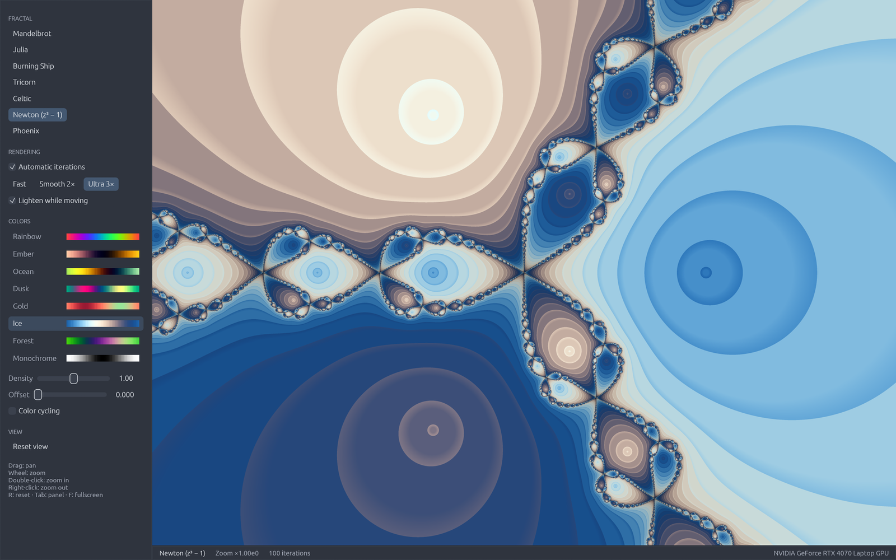

# fractals

A real-time fractal explorer written in Rust. Every pixel is computed on the GPU by a WGSL fragment shader (via [wgpu](https://wgpu.rs)), with a UI built on [egui](https://www.egui.rs).



## Features

- **Seven fractals**: Mandelbrot, Julia, Burning Ship, Tricorn, Celtic, Newton (z³ − 1) and Phoenix.
- **Deep zoom** for Mandelbrot and Julia using perturbation theory: a reference orbit is computed in `f64` on the CPU, and the GPU only iterates the (small) offset from it, with rebasing to avoid glitches. This allows zoom levels well beyond what `f32` alone can reach (the Seahorses preset is already at ~10¹⁰).
- **Smooth coloring** with eight cosine palettes, adjustable density and offset, plus an optional color cycle.
- **Presets**: famous places of the Mandelbrot set (Seahorse Valley, Elephant Valley, mini-Mandelbrots...) and famous Julia constants (Douady rabbit, Siegel disk, Fatou dust...).
- **Generalized exponent** (2 to 8) for Mandelbrot, Julia, Burning Ship, Tricorn, Celtic and Phoenix.
- **Rendering options**: automatic or manual iteration count, 1×/2×/3× supersampling, and a lighter mode while moving.
- Smooth camera, cursor coordinates in the status bar, and a warning when the precision limit is reached.

## Screenshots

| Seahorse Valley (deep zoom) | Mini-Mandelbrot (deep zoom) |
| --- | --- |
|  |  |

| Julia set | Burning Ship |
| --- | --- |
|  |  |



## Build and run

You need a recent Rust toolchain (edition 2024) and a GPU with Vulkan, Metal or DX12 support.

```sh
cargo run --release
```

## Controls

| Input | Action |
| --- | --- |
| Drag | Pan |
| Mouse wheel / pinch | Zoom at the cursor |
| Double-click | Zoom in |
| Right-click | Zoom out |
| `R` | Reset the view |
| `Tab` | Toggle the side panel |
| `F` / `F11` | Toggle fullscreen |

## Project layout

- `src/main.rs`: window and wgpu setup.
- `src/app.rs`: UI, camera and input handling.
- `src/fractal.rs`: fractal kinds, presets and palettes.
- `src/gpu.rs`: wgpu pipeline and uniforms.
- `src/fractal.wgsl`: the fractal shader (escape time, Newton, perturbation).
